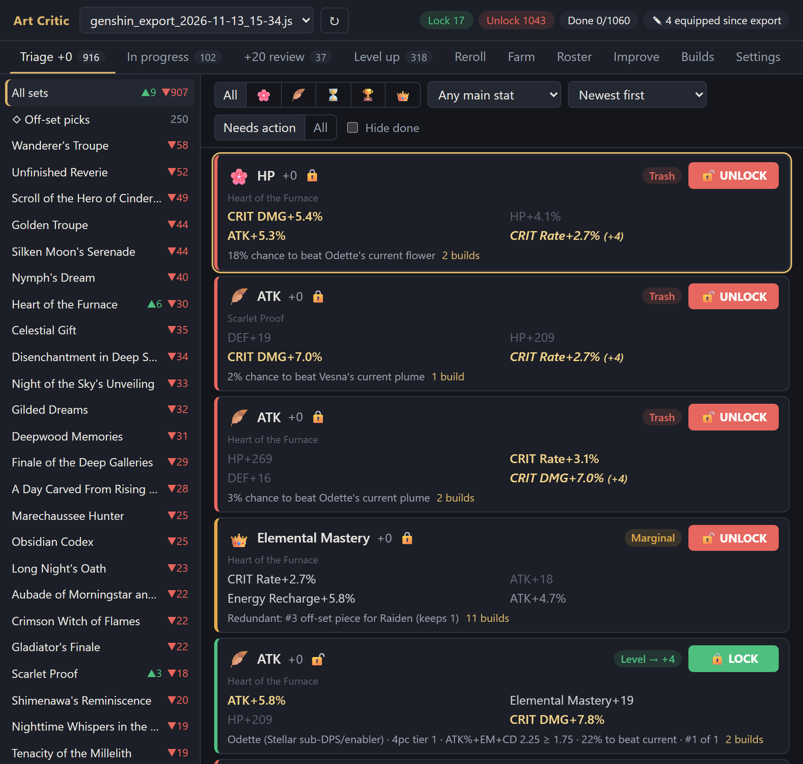
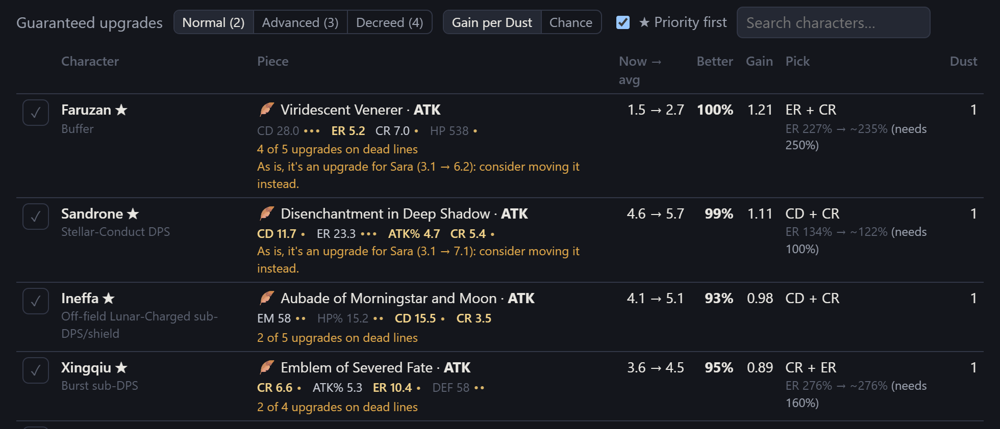
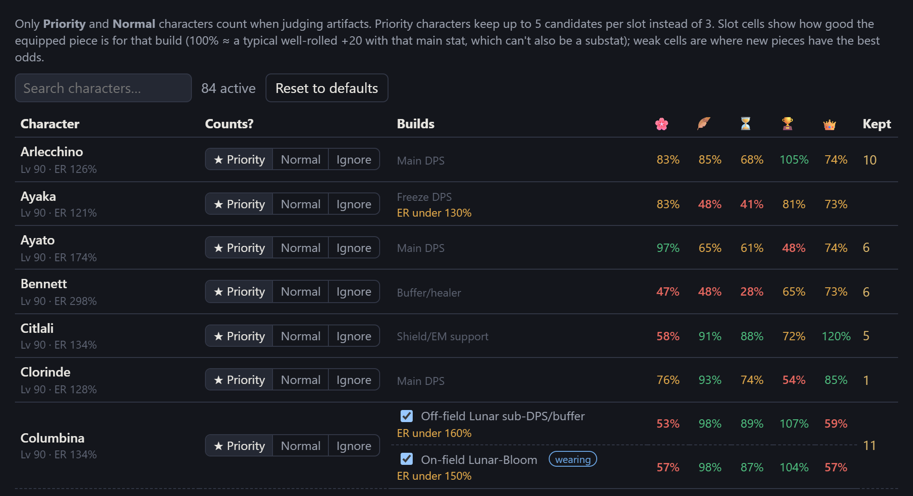
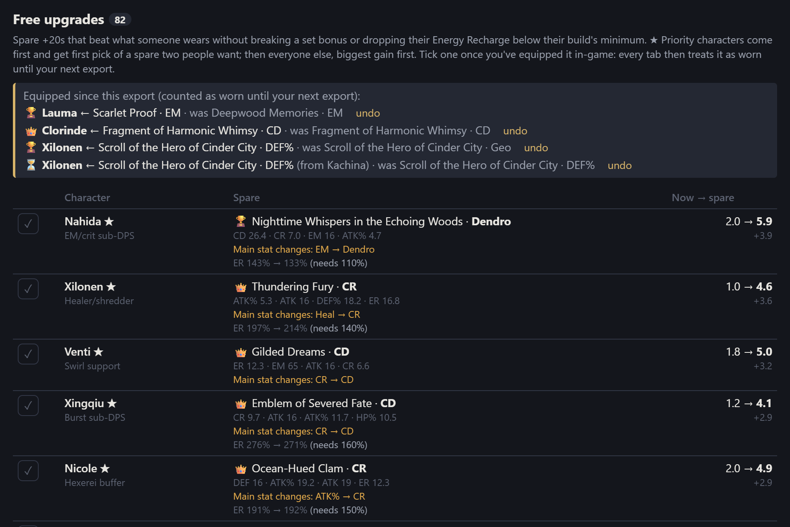

# art-critic
A tool for rating the quality of your Genshin Impact artifacts: which to lock and level, which to unlock and feed.

It reads an [Irminsul](https://github.com/konkers/irminsul) GOOD export plus `genshin_artifact_config.json` (builds, set tiers, substat weights) and, for the Farm tab, `genshin_artifact_domains.json` (which sets drop together). Weapon and ascension stats for Energy Recharge come from `data/game-data.json` (see [Energy Recharge](#energy-recharge)). It runs as a local web page you keep next to the game while you lock and unlock pieces.



## Setup

1. Install [Node.js](https://nodejs.org/) 22.12 or newer.
2. Export your account with Irminsul and drop the `.json` into `imports/`. The newest file is loaded automatically, and the page shows a banner when a new one appears.
3. Double-click `start.bat` (or run `npm install` once, then `npm run dev`). The page opens at http://localhost:5317.
   - The first start needs internet: it installs packages and downloads the game data used for Energy Recharge.
   - After pulling changes that add packages, run `npm install` again.

## Using it

- **Triage +0**, **In progress** (+1 to +19) and **+20 review** list pieces whose lock state should change.
  - **LOCK** means keep: level it to the next stop (+4, +8, …), then re-export and check again.
  - **UNLOCK** means feed or salvage it.
- Pick a set in the left rail and apply the same set filter in-game. Use the sort menu to match the in-game order; "Newest first" follows acquisition order. The slot and main-stat filters help find a specific piece.
- Click the action button (or press <kbd>Space</kbd>) once you've done it in-game, and the list moves to the next piece. Use <kbd>↑</kbd>/<kbd>↓</kbd> to move and <kbd>Z</kbd> to undo. Click a card's "builds" link to see why it got its verdict.
- **Level up** is the leveling queue: every piece worth leveling, already locked or not, plus equipped pieces worth finishing.
  - Level each piece only to its next stop (+4, +8, …). Every 4 levels adds one roll, and the early stops are cheap: +0 → +4 costs about 6% of the EXP to +20. Then re-export, and the piece is re-scored with what it actually rolled: it either continues or drops to "Stop & feed".
  - Each card lists the characters it could go to, with the chance it ends up beating what they wear once it reaches +20. Sorted by that chance by default.
  - With "★ Priority first" on (the default), pieces that could go to a ★ Priority character come first, and their chips lead each card.
  - The button marks it leveled (separately from lock marks).
- **Reroll** ranks the +20s your characters wear by how much a Dust of Enlightenment reroll would help, judged by the build each character is wearing.
  - A reroll redoes a piece's upgrades from its starting values, with at least 2 landing on the two lines you pick (3 with Advanced Reshape, 4 with Decreed; switch at the top). The suggested pick is the two lines the build weights most.
  - You can keep the old stats, so a reroll never loses value. "Better" is the chance it comes out ahead, and "Gain" is the average improvement (a worse roll counts as 0), ranked per Dust: 1 for a flower or plume, 2 otherwise.
  - Dots show which lines each upgrade went to, and the row counts how many landed on stats the build doesn't use. It's computed exactly from the starting values in the export.
  - A piece worth at least 2 rolls more to someone else, and better than a real piece they wear, is flagged "consider moving it instead". Rerolling would throw that value away.
  - Each row shows the wearer's ER now and on average after the reroll. When the piece's ER line is needed to stay at the build's ER minimum, results that lose it count as no change, and the suggested pick may include ER (sometimes paired with a dead line, so the guaranteed upgrades feed ER and the free ones go to the good lines).

  
- **◇ Off-set picks**, at the top of each list's set rail, gathers pieces kept as someone's off-set piece. Find these in-game by slot and main stat, not by set.
- **Builds** edits what each character uses: 4pc sets and tiers, allowed main stats per slot, and substat weights (or a preset). Edits are saved in `state/user-state.json` on top of the config, so "Reset to research config" undoes them. Everything re-scores live.
- **Farm** answers where new pieces should come from. See [Farming](#farming).
- **Roster** sets who counts:
  - Default: owned Lv 80+ characters are Normal, the rest are Ignored.
  - ★ Priority characters keep more candidates per slot.
  - Multi-build characters can switch builds on or off.
  - The slot cells show how good each equipped piece is, against what's possible with its main stat; low numbers are where new pieces have the best odds.
  - Each character shows their total Energy Recharge, and a build flags it when they're under its minimum.
  - Click a name to open it in **Improve**.

  
- **Improve** puts every way to improve one character's pieces side by side, weakest slot first. The rail lists active characters, ★ Priority first and then by weakest slot.
  - **Spare +20:** unequipped pieces that beat what they wear, flagged when Free upgrades already gives one to someone else.
  - **From another character:** pieces others wear, showing what the current wearer loses. Ignored characters' pieces come first, since they cost nothing.
  - **Level:** unequipped pieces still to level, with the chance they beat the worn piece at +20. Pieces Triage marks to unlock are flagged, so you can lock them first.
  - **Reroll**, **Sanctifying Elixir**, **Strongbox** (per batch of 13) and **Domain** (per 200 resin), with the same odds as their tabs.
  - Each option shows its chance of beating the worn piece, its average gain (a miss counts as no change) and its cost. Pieces that would cost a set bonus are dimmed; pieces that only fit another listed 4pc set say so. The build switcher looks at a character's other builds.

  
- **Settings** has every threshold, with live keep/toss counts.

**Equips since the export.** Tick a free upgrade on the Farm tab, or press Equip on a spare or another character's piece in Improve, once you've done it in-game. Every tab then treats the piece as worn until your next export: the character's ratings, farming odds and rerolls update, and the piece it replaced is judged as a spare (taking a piece from another character swaps the two, as the game does). The header counts them, and the Farm tab lists them with undo. They belong to the export they were made on, so a new export starts clean, even one saved over the old file.

Settings, roster choices, build edits, the Strongbox list, done marks and equips are saved to `state/user-state.json`. Git ignores `state/` and your exports in `imports/`, so your account data stays on this machine.

## How a piece is judged

For each active character build, a piece goes through four layers:

1. **Set:** the set must be one of the build's 4pc sets, tier 1–2 by default. You can widen this to all tiers, or to the config's 2pc categories (very loose with a big roster).
   - **Sticking to the worn set:** once a character wears one of their 4pc sets, another set only counts for them if it's ranked a better tier. For example, Vesna in tier-1 Scarlet Proof no longer collects tier-2 VV flowers, but someone in their tier-2 set still collects tier-1 pieces. Pieces they're wearing always count. There's a Settings toggle to turn this off.
   - **Off-set:** a 4pc build has one free slot, so a piece of any set can qualify as the off-set piece. By default this covers rare main stats only (Elemental/Physical DMG, EM and Healing goblets; CRIT, EM and Healing circlets; ER and EM sands). Each build keeps only its best off-set candidate across all slots, ranked by gain over what it wears.
2. **Main stat:** the main stat must be acceptable for the slot, and not on the build's `avoidMainStats` list.
3. **Substats:**
   - At +0, the config rule applies: the sum of the build's weights over the starting lines (including the hidden 4th line of a 3-liner) must reach 1.75 for a 4-liner or 1.5 for a 3-liner.
   - Past +0, the piece is re-scored on its projected +20 value, so a borderline piece whose early rolls missed drops out.
   - CRIT circlets with the other CRIT stat as a line always pass.
   - **Scaling:** the thresholds scale so every build needs the same share of what it can reach. There are two parts, each with a Settings toggle:
     - **Main stat:** a piece can't roll its main stat as a substat, so the bar drops by the share of the build's four best weights it blocks. Nilou's HP% sands can reach 1.10 (flat HP, ER, EM) against 2.10 for her plume. Without this, 117 build/main-stat pairs in the config could never pass.
     - **Few useful stats:** a build whose four best weights add up to less than a typical CRIT DPS's 3.05 (CRIT Rate, CRIT DMG, ATK%, flat ATK) is measured against 3.05 instead. That's 50 of 141 builds, mostly single-stat supports: Nilou's plume bar becomes 1.75 × 2.10 / 3.05 = 1.20, and her HP% sands 1.75 × 1.10 / 3.05 = 0.63. Their key stat is still effectively required, and builds at 3.05 or more (Skirk, most DPS) are unchanged.
4. **Upgrade chance:** the chance that the finished piece beats what that character wears in the slot now. The minimum is 20% by default. It is computed exactly from the remaining rolls.

Then a **cap** applies: per character, build and slot, only the best 3 unequipped candidates are kept (5 for Priority characters). Spare +20s count toward the cap, so good spares you already have crowd out speculative +0s.

The verdicts:

- **Keep:** passed everything.
- **Marginal:** passed everything but the cap. Unlocked by default; there's a setting to keep them locked.
- **Toss:** failed a layer. The card says which.

Equipped pieces are never unlocked. Unequipped +20s are only marked to feed if no active build wants them. A decent +20 that doesn't beat what anyone wears stays locked as a "Backup".

A card's "builds" link shows each layer for every build that could use the piece:


Units: a piece's value is Σ weight × (substat value ÷ max roll), so one max CRIT Rate roll is 1.0.

## Farming

The Farm tab simulates leveled-up 5★ pieces using the game's slot, main stat and substat odds, then scores each against what every active character wears. Characters with several builds are judged by the one they're wearing: its 4pc set first, then how many main stats fit.

- **Free upgrades:** spare +20s that beat a worn piece without breaking a 2pc or 4pc bonus or taking the character below their build's ER minimum. Each spare and each slot is used once. Rows show the ER change, and flag a swap that changes the main stat (EM goblet → Dendro DMG goblet, say): scores compare substats only, so that trade is yours to judge. ★ Priority characters are listed first and get first pick of a spare two people want; within each group, biggest gain first. Everything below assumes you've made these swaps. Tick one once it's equipped and every tab counts it as worn (see [Equips since the export](#using-it)).

  
- **Where to spend resin:** domains ranked by expected gain from 200 resin (10 runs, about 10.7 five-star drops). It's the per-drop gain times the drops, so slightly optimistic: a second upgrade to the same slot has to beat the first.
  - Each character farms the tier 1–2 set they already wear, or else their build's best-tier sets.
  - Sets that no domain drops are listed separately.

  
- **Strongbox:** the same ranking per set, for one full batch: 39 five-star pieces in, 13 of the chosen set out.
  - Only sets the Strongbox offers count. The built-in list (`STRONGBOX_SETS` in `src/engine/farm.ts`) is the in-game one as of 7.2: 40 sets, leaving out A Day Carved From Rising Winds, Aubade of Morningstar and Moon, Celestial Gift, Disenchantment in Deep Shadow, Heart of the Furnace and Scarlet Proof. When the game adds sets, tick them under the Strongbox ranking; your list is saved and replaces the built-in one.
- **Sanctifying Elixir:** each character's best craft (slot, main stat, and the two highest-weighted substats).
  - Crafts are ranked per Elixir by the gain they add beyond what ~50 domain runs would likely bring that slot anyway. Easy slots like the plume, which always rolls the right main stat, rarely win.
  - "Farming instead" shows how many runs it takes on average to expect an equally big upgrade.
- **Who gains most:** every active character, with their set bonus status, upgrade chance and expected gain per on-set piece, and the slots that gain comes from. "(none)" marks a slot that's empty, 4★, or has a main stat the build doesn't list.

Resin, Strongbox and Elixir rankings count ★ Priority characters by default. If nobody is Priority, or you switch the toggle, they count every active character.

## Energy Recharge

ER isn't worth a fixed amount per roll: short of what a character needs it matters a lot, past it barely at all. So instead of trusting its weight, the Farm and Reroll tabs treat ER as a requirement:

- **Total ER** = 100% + ascension stat + weapon substat (and any unconditional refinement bonus) + ER main stats and lines on the equipped artifacts + 20% per active Emblem, Silken Moon's Serenade or Celestial Gift 2pc. The export says which weapon each character holds; the stats come from [Genshin Optimizer](https://github.com/frzyc/genshin-optimizer)'s data. The dev server downloads it from GitHub on first start, trims it into `data/game-data.json` (not committed), and refreshes that file when it's a week old, so new weapons and characters show up without anything to type in. Until the first download succeeds, ER isn't shown or checked.
- **The minimum** is the low end of the build's ER target in Builds ("110-130%" → 110%). A target without a percentage ("Low") sets no minimum.
- Weapon passives, constellations and team buffs aren't counted. A character whose weapon isn't in the export or the data shows no ER and isn't checked.

Assumptions, all in `src/engine/farm.ts`:
- 4-line chance: 20% for domain pieces, 34% for Strongbox pieces (community figures).
- Elixir pieces start with 4 lines, and at least 2 of their 5 upgrades land on the chosen lines (the 5.5 change).
- Elixir cost: 1 for a flower or plume, 2 for sands, 4 for a goblet, 3 for a circlet.
- About 1.07 five-star drops per domain run, half of them from the set you want.

## Development

```
npm test             # engine unit tests, plus a regression run over the newest export in imports/ (skipped without one)
npm run test:watch
npm run typecheck
```

There's no production build: the API runs inside the Vite dev server, so `npm run dev` (or `start.bat`) is how the tool runs.

- `src/engine/` is the scoring engine (pure TypeScript, unit-tested):
  - `load.ts` reads the export and applies equips made since it; `match.ts` and `evaluate.ts` judge each piece; `projection.ts` has the roll odds; `stats.ts` has stat and set names.
  - `farm.ts` is the farming planner, `reroll.ts` the reroll odds, `improve.ts` the Improve tab, `er.ts` Energy Recharge totals, and `builds.ts` the Builds tab's edits.
- `src/state/store.tsx` loads everything and saves your state. `src/ui/` holds the React views.
- `server/artCriticPlugin.ts` is the dev-server API that serves exports, config, game data and saved state. `server/gameData.ts` downloads and refreshes `data/game-data.json`.

## License

Apache 2.0, see [LICENSE](LICENSE). The stat data is downloaded from Genshin Optimizer at runtime, not redistributed here.
