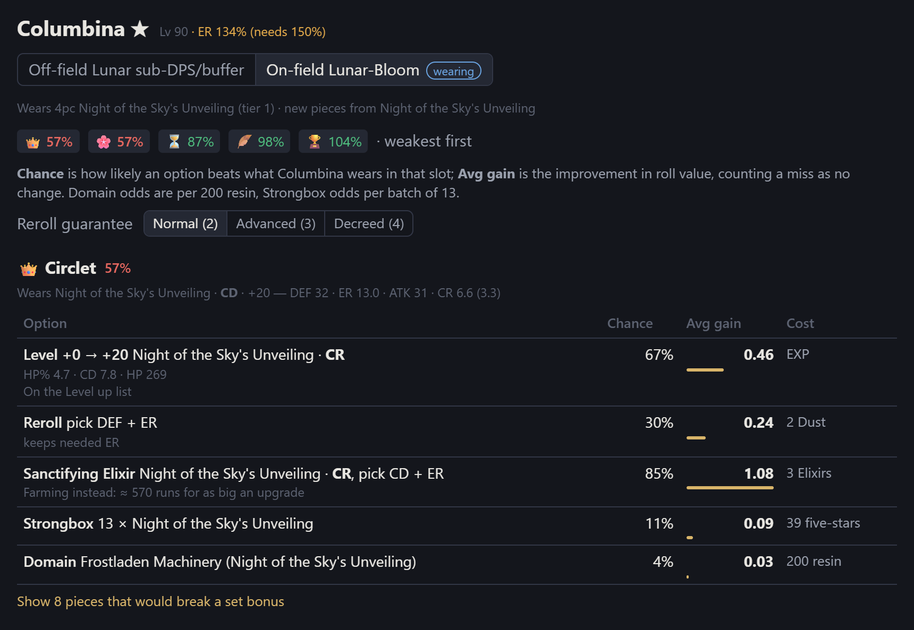
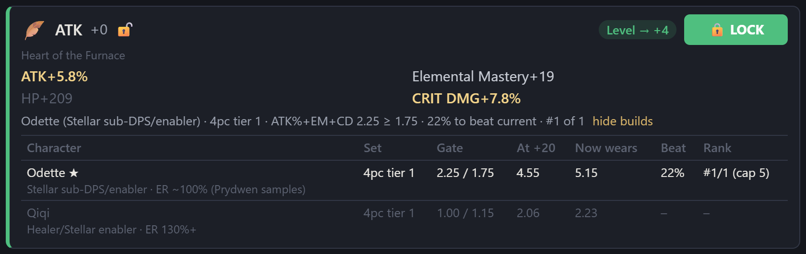

# art-critic
A tool for rating the quality of your Genshin Impact artifacts: which to lock and level, which to unlock and feed.

It reads an [Irminsul](https://github.com/konkers/irminsul) GOOD export plus `genshin_artifact_config.json` (builds, set tiers, substat weights) and, for the Farm tab, `genshin_artifact_domains.json` (which sets drop together). Weapon and ascension stats for Energy Recharge come from `data/game-data.json` (see [Energy Recharge](#energy-recharge)). It runs as a local web page you keep next to the game while you lock and unlock pieces.


## Setup

1. Install [Node.js](https://nodejs.org/) 22.12 or newer.
2. Double-click `start.bat` (or run `npm install` once, then `npm run dev`). The page opens at http://localhost:5317.
   - The first start needs internet: it installs packages and downloads the game data used for Energy Recharge.
   - After pulling changes that add packages, run `npm install` again.
3. Export your account with Irminsul, press **Load export…** at the top of the page and choose the `.json` it wrote, wherever it is. The file is copied into `imports/` and loaded.
   - Exports in `imports/` are listed newest first in the menu beside the button, and the newest is loaded when the page opens. A copy keeps the original's modified time, so loading an old export doesn't make it the newest.
   - Loading the same file again just selects it. A different file with a name that's already in `imports/` is saved as `name (2).json`, so nothing there is overwritten.
   - You can also drop the `.json` into `imports/` yourself. The page shows a banner when a new one appears there.

## Configure

Every character comes with a researched build, so you can start right away. It's worth a few minutes to tell the tool who you're building and how. Everything you change is saved in `state/user-state.json` and re-scores live.

**Mark your priorities** in the **Roster** tab:

1. Owned Lv 80+ characters start as Normal and the rest as Ignored. Change each one as needed:
   - **★ Priority:** who you're actively building. They keep 5 candidates per slot instead of 3, come first in Level up and Improve, and get first pick of free upgrades. Once anyone is Priority, the resin, Strongbox and Elixir rankings count only Priority characters.
   - **Normal:** counts when judging pieces.
   - **Ignore:** doesn't count. Use it for characters you don't play, so pieces aren't kept locked for them.
2. For a character with more than one build, untick the builds you don't run.
3. Pin who you're **📌 Building** right now with the pin beside their name (here or in Improve). Priority is who you care about getting good pieces overall; Building is the few you're working on now, toggled in and out as you change who you farm for. They're listed in the header (✕ unpins one) and:
   - come first in Roster, Improve, the To level queue, the Reroll list and the Farm tab's tables, ahead of ★ Priority characters;
   - get first pick of a free upgrade two characters want;
   - are who the resin, Strongbox, Elixir and Feed or box rankings count by default (switch above those rankings). With nobody pinned, those count ★ Priority characters as before;
   - count toward the ⬆ and ⟳ badges' heat, as ★ characters do.

   It changes no verdict: what to lock is still decided by ★ Priority and Normal. Pinning an Ignored character makes them Normal, so they count.

"Reset to defaults" puts everyone back to the Lv 80 rule.

**Set your preferred builds** in the **Builds** tab:

1. Pick a character from the list. Tick "Include unowned" to plan for someone you don't have yet.
2. Change whatever doesn't match how you play them:
   - **4-piece sets:** tier 1 is best, and tiers 1–2 count when deciding what to keep. Add a set from the dropdown, or remove one with ✕.
     - **2pc only:** keeps a set's pieces for the build's 2-piece pairs without preferring its 4pc over them. Nilou's Bloom build runs Tenacity of the Millelith 2pc + Vourukasha's Glow 2pc for 40% HP. Neither 4pc helps Bloom, and either costs her 20% HP, so both are marked, in her C6 hybrid build too. A set marked this way still counts at its tier when keeping pieces. Free upgrades won't give up a 2pc to complete its 4pc, but will take a piece back from its 4pc to make a pair (see [Free upgrades](#farming)). Wearing its 4pc doesn't stop its partner sets counting (see [Sticking to the worn set](#how-a-piece-is-judged)).
   - **2-piece pairs:** two 2pc bonuses the build is happy with instead of a 4pc, such as ATK + ATK. A swap may trade one 2pc bonus for another as long as what's left still makes one of these pairs (see [Free upgrades](#farming)). Add a pair with the two pickers, or remove one with ✕.
     - The config lists pairs only for builds commonly run 2pc + 2pc: Nilou (both builds), Vodyanitsa and Zhongli's shielder build (HP + HP, when someone else holds Tenacity), Illuga (EM + EM, before C2 unlocks Silken Moon's Serenade), Shenhe (ATK + ATK when someone else holds Noblesse, or a Celestial Gift 2pc for ATK + ER toward her 180-200% ER target) and Mona's Hexerei support build (ATK + ER, the same Celestial Gift pairing). Every other build wants a 4pc, so free upgrades won't break one of its 2pc bonuses unless that completes one of its 4pc sets. If you run someone 2pc + 2pc, add the pair.
   - **Main stats:** toggle the sands, goblet and circlet main stats you'd accept.
   - **Substat weights:** pick a preset, or drag the sliders (1 = fully wanted, 0 = useless).
   - **ER target:** for example "120-140%". The low end becomes the build's ER minimum, and ER past the high end counts for nothing (see [Energy Recharge](#energy-recharge)).
3. To run a second build alongside the first, click "+ Copy build", rename it and edit the copy.

"Reset to research config" undoes all edits for that character.

To find which build a particular piece is missing from, open it with [Closest build](#closest-build).

## Using it

- **Artifacts** is where you work through your pieces. Pick a set in the left rail and apply the same set filter in-game. "« Sets" folds the rail away for more room (a dropdown in the filter bar picks the set instead), and "» Sets" brings it back. It has two views, switched at the top, and an inspector beside them:
  - **Grid** lays out the set's pieces in the same order and grid as the game's inventory, every level and lock state at once, so you can lock and unlock in one pass without filtering further.
    - **In-game:** open the inventory, set Filter → Set to the set picked in the left rail, and add Not Equipped (or tick "Include equipped" here if you don't). Leave "Show 5-star Artifacts in the order of when they were obtained" off. Then work along both grids together.
    - **Each cell** shows the slot, main stat and level, with 🔒 where the piece is locked now, as the game shows it. A green **LOCK** or red **UNLOCK** bar along the bottom says what to change; dimmed cells are already right. Hover a cell for the reason for its verdict.
    - **Click a piece** to open it in the inspector (below), outlined. Click its **LOCK**/**UNLOCK** bar once you've changed it in-game, or use "Mark all done" at the end. The grid doesn't move when you do, since the game only re-sorts when the inventory is opened again. After reopening it, tick "Reopened since marking" to order by the new lock states.
    - **Keys:** <kbd>←</kbd><kbd>→</kbd><kbd>↑</kbd><kbd>↓</kbd> move the outline across the grid, <kbd>Space</kbd> marks the outlined piece's lock change done and moves to the next piece with one still to make, <kbd>L</kbd> marks it leveled, <kbd>R</kbd> rerolled, and <kbd>Esc</kbd> closes the inspector.
    - **Substats** (on by default; untick to shrink the cells) lists each piece's lines under it, so you can check you're on the right piece. They're colored like the cards, by how much the build the piece is judged for weighs them, and a line still to be revealed at +4 is in italics.
    - **⬆+4** in the corner marks a piece in the To level queue, with the stop to level it to. It gets hotter with the piece's expected gain once finished: the average improvement over the best the character has (what they wear, or a better finished spare), a miss counting as 0, for a 📌 Building or ★ Priority character (or anyone, when nobody is ★). The steps are fixed, so a hot badge means the same in every set: grey below 0.5 rolls, cyan outline from 0.5, blue from 1 (**high priority**), violet from 2, and glowing magenta from 3. From blue up, the cell gets a stripe of the same color across its top. Hover for the character, the gain and the chance. The rail counts each set's high-priority pieces (⬆), and pieces marked leveled show ✓.
    - **⟳** marks a +20 worth a Dust of Enlightenment reroll, rated as on the [Reroll](#using-it) tab with the guarantee picked there: a worn piece, or a spare that rerolled could beat what someone wears. It's shaded on the same steps as ⬆, by the expected gain from one reroll (a worse result counting as 0; for a spare, over the piece it would replace), for a 📌 Building or ★ Priority character (or anyone, when nobody is ★): it appears from 0.5 rolls, and from 1 (blue) it's high priority. It's the gain, not the gain per Dust the Reroll tab sorts by, so it means the same as ⬆. A worn piece worth more moved to someone else gets none. With "Include equipped" off, the line above the grid says how many of the set's equipped pieces have one, as a link that ticks it. Hover for the character, the gain, the chance, the two lines to pick and the Dust. Rerolls are scarcer than pieces to level, so the rail counts each set's rerolls from 0.5 rolls (⟳, in cyan, or blue when one is high priority), not just the high-priority ones. Pieces marked rerolled show ✓.
    - **The order** is level high to low, then flower → circlet, then locked before unlocked, then pieces that started with 4 lines before those that started with 3 (even at +20, when both have 4), then newest first. It was worked out from in-game screenshots and confirmed against more of the same grids.
    - **Per row** sets the grid width: 8 matches the game on PC. Row numbers help keep your place.
    - The export only has 5★ pieces, so any 4★ pieces of the set in your inventory will shift the grid.

    
  - **List** shows a card per piece with its verdict and why, across sets ("All sets") or one at a time. Two filters do what separate tabs used to:
    - **Show:** **Lock changes** (**LOCK** means keep: level it to the next stop, +4, +8, …, then re-export and check again; **UNLOCK** means feed or salvage it), **To level** (the leveling queue, below) or **Everything**.
    - **Level:** Any, **+0** (what the Triage tab was), **+1–19** (In progress) or **+20 spare** (+20 review: unequipped +20s).
    - Use the sort menu to match the in-game order; "Newest first" follows acquisition order. The slot and main-stat filters help find a specific piece.
    - Click the action button (or press <kbd>Space</kbd>) once you've done it in-game, and the list moves to the next piece. Use <kbd>↑</kbd>/<kbd>↓</kbd> to move and <kbd>Z</kbd> to undo. Click a card's "builds" link to see why it got its verdict, the character its reason names to open the build that decided it (the builds table's names open theirs), "inspect" to open it in the inspector, or "find in grid" to see it outlined in the grid, with its row and place in the row.
  - **To level** is the leveling queue: every piece worth leveling, already locked or not, plus equipped pieces worth finishing.
    - Level each piece only to its next stop (+4, +8, …). Every 4 levels adds one roll, and the early stops are cheap: +0 → +4 costs about 6% of the EXP to +20. Then re-export, and the piece is re-scored with what it actually rolled: it either continues or drops to "Stop & feed".
    - Each card leads with its **expected gain** (⬆): the average improvement once finished over the best the character it's kept for has (what they wear, or a better finished spare: see [Upgrade chance](#how-a-piece-is-judged)), a miss counting as 0. It's the same number and color as the grid's [⬆ badge](#using-it), for a 📌 Building or ★ Priority character when it's kept for one. The queue sorts by it by default, so it lists the pieces in the same order the grid rates them.
    - Then come the characters it could go to, with the chance it ends up beating the best they have once it reaches +20. "Upgrade chance" sorts by that instead. Many pieces are sure upgrades, so pieces tied on chance go by expected gain.
    - With "📌 ★ first" on (the default), pieces kept for a 📌 Building character come first, then those for a ★ Priority one (by chance: pieces that could beat what one wears), and their chips lead each card.
    - The button marks it leveled (separately from lock marks), as <kbd>L</kbd> does in the grid.
  - **The inspector** opens beside either view, for the piece you clicked: its substats, verdict and why, buttons to mark it done, leveled or rerolled (with what leveling or rerolling it is worth), its builds table, and [Closest build](#closest-build): the builds nearest to keeping it, with the set and main-stat edits that would. Edits made there re-score everything at once, so you can watch the verdict change. "edit in Builds →" opens the build in the Builds tab for weights and the rest; its "← Back to Artifacts" link, or the browser's Back button, returns to the grid as you left it, with the piece still open. ✕ (or <kbd>Esc</kbd> in the grid) closes it.
    - **Where it sits:** the switch in its heading docks it at the side (◨) or the bottom (⬓). At the bottom it lays the piece and its nearest builds beside the build on screen's layers, using the width. **Auto**, the default, puts it at the bottom while the window is taller than wide (a portrait monitor) and at the side otherwise.
    - **Its size:** drag its inner edge (left at the side, top at the bottom); double-click the edge for the default size. Each dock remembers its own size.
    - On a window narrower than 900 px, docked at the side, it slides over the grid from the right instead.
  - The view, set and inspected piece are kept in the page's address, so Back and bookmarks return to them. Old links to the Triage, In progress, +20 review, Level up and Inventory tabs open the matching view.
- **Reroll** ranks +20s by how much a Dust of Enlightenment reroll would help: the ones your characters wear, judged by the build each is wearing, and spares (see below). Switch between them, or show both, at the top.
  - A reroll redoes a piece's upgrades from its starting values, with at least 2 landing on the two lines you pick (3 with Advanced Reshape, 4 with Decreed; switch at the top). The suggested pick is the two lines the build weights most.
  - You can keep the old stats, so a reroll never loses value. "Better" is the chance it comes out ahead, and "Gain" is the average improvement (a worse roll counts as 0), ranked per Dust: 1 for a flower or plume, 2 otherwise.
  - Dots show which lines each upgrade went to, and the row counts how many landed on stats the build doesn't use. It's computed exactly from the starting values in the export.
  - A piece worth at least 2 rolls more to someone else, and better than a real piece they wear, is flagged "consider moving it instead". Rerolling would throw that value away.
  - Each row shows the wearer's ER now and on average after the reroll. When the piece's ER line is needed to stay at the build's ER minimum, results that lose it count as no change, and the suggested pick may include ER (sometimes paired with a dead line, so the guaranteed upgrades feed ER and the free ones go to the good lines). When the wearer would still be past their ER target without the line, the line is spare and counts for nothing.
  - **Spare** +20s (unequipped) are judged for each character who could wear one: their build takes its main stat, and putting it on keeps their set bonuses (the same rule as [Free upgrades](#farming)). A reroll has to beat the piece it would replace, so "Better" is the chance it ends up past that piece and "Gain" the average improvement over it. Each spare is listed once, for the character it gains most, 📌 Building first, then ★ Priority while anyone is ★. [Free upgrades](#farming) are left out, both the spares it lists and the slots they fill: it says to equip those first, rerolling one of its spares for someone else would undo that, and a slot it fills is getting a better piece than the one a reroll would be measured against. Once a spare is equipped, it's judged as a worn piece.
    - ER works as it does for worn pieces, with the ER total the character would have wearing the spare: results that would leave them below their build's ER minimum (or lower than they are now, when already under it) count as no change. A spare with no ER line that would do that isn't listed. When ER is all spare, neither piece's ER line counts.
    - The row says which piece it would replace, and flags a main stat change: scores compare substats only, so that trade is yours to judge. It also flags a spare triage marks to feed, so you can keep it locked.
  - A gain of 0.5 rolls or more gets the grid's [⟳ badge](#using-it), in the same colors: from 1 roll (blue) it's high priority, for a 📌 Building or ★ Priority character when anyone is ★. The note at the top counts the high-priority pieces not yet marked rerolled. "find in grid" opens the piece in the Artifacts grid, outlined. With "📌 Building, ★ Priority first" on, their pieces lead the list.

  
- **◇ Off-set picks**, at the top of the list's set rail, gathers pieces kept as someone's off-set piece. Find these in-game by slot and main stat, not by set.
- **Builds** edits what each character uses: 4pc sets and tiers, allowed main stats per slot, and substat weights (or a preset). Edits are saved in `state/user-state.json` on top of the config, so "Reset to research config" undoes them. Everything re-scores live. "Improve →" opens the character in Improve, and when you came from another tab, "← Back to …" returns to it as you left it.
- **Farm** answers where new pieces should come from. See [Farming](#farming).
- **Roster** sets who counts:
  - Default: owned Lv 80+ characters are Normal, the rest are Ignored.
  - ★ Priority characters keep more candidates per slot.
  - Multi-build characters can switch builds on or off.
  - 📌 beside a name puts them on the Building list (see [Configure](#configure)); pinned characters are listed first.
  - The slot cells show how good each equipped piece is, against what's possible with its main stat; low numbers are where new pieces have the best odds.
  - Each character shows their total Energy Recharge, and a build flags it when they're under its minimum.
  - Click a name to open it in **Improve**.

  
- **Improve** puts every way to improve one character's pieces side by side, weakest slot first. The rail lists active characters, 📌 Building first, then ★ Priority, then lowest-rated first. The 📌 button beside the name pins or unpins them, and "Edit build →" opens the build they're judged by in the Builds tab. "Sort by" switches the rating between Min, their weakest equipped piece, and Avg, the average of their five (an empty or unusable slot counts as 0%).
  - **Spare +20:** unequipped pieces that beat what they wear, flagged when Free upgrades already gives one to someone else. ER is judged by what the piece does to the character's total, against their ER target (see [Energy Recharge](#energy-recharge)).
  - **From another character:** pieces others wear, showing what the current wearer loses. Ignored characters' pieces come first, since they cost nothing.
  - **Level:** unequipped pieces still to level, with the chance they beat the worn piece at +20. Pieces Triage marks to unlock are flagged, so you can lock them first.
  - **Reroll a spare:** unequipped +20s that a reroll could lift past the worn piece (up to 3), judged as on the [Reroll](#using-it) tab, but for this character whoever else they'd suit. They're flagged when Free upgrades gives the spare to someone else. Like leveling, pieces that would break a set bonus aren't listed.
  - **Reroll** (the worn piece), **Sanctifying Elixir**, **Strongbox** (per batch of 13) and **Domain** (per 200 resin), with the same odds as their tabs.
  - Each option shows its chance of beating the worn piece, its average gain (a miss counts as no change) and its cost. Pieces that would cost a set bonus are dimmed; pieces that only fit another listed 4pc set say so, and so do pieces that trade a 2pc for another the build lists. The build switcher looks at a character's other builds.

  
- **Settings** has every threshold, with live keep/toss counts.

**Equips since the export.** Tick a free upgrade on the Farm tab, or press Equip on a spare or another character's piece in Improve, once you've done it in-game. Every tab then treats the piece as worn until your next export: the character's ratings, farming odds and rerolls update, and the piece it replaced is judged as a spare (taking a piece from another character swaps the two, as the game does). The header counts them, and the Farm tab lists them with undo. They belong to the export they were made on, so a new export starts clean, even one saved over the old file.

Settings, roster choices, build edits, the Strongbox list, done marks and equips are saved to `state/user-state.json`. Git ignores `state/` and your exports in `imports/`, so your account data stays on this machine.

### Closest build

For a piece marked UNLOCK that you'd rather keep, Closest build finds the build it's nearest to being kept for, and shows what in that build stands in the way. It's in the Artifacts tab's inspector: click a piece in the grid, or a card's "inspect". A character's name in a card's builds table (or in its reason) opens it in the Builds tab instead, at their build, with the piece pinned above the editor. Either way it shows:

- **Now** is the piece's verdict. It updates as you edit the build below, so you can see the moment it turns into a keep.
- **Nearest to keeping it** lists the active builds, each as if it counted the piece:
  - **Main stat:** a main stat the build doesn't accept is allowed.
  - **Set:** only for a piece that can't be the build's [off-set piece](#how-a-piece-is-judged), since an off-set piece can be of any set. With the default Off-set setting, Rare main stats, that's every flower and plume and every sands, goblet or circlet with a common main stat. The Set row then says so: with Settings → Off-set pieces on Any slot, the piece could fill the build's free slot without listing its set. A set the build doesn't list is added at the lowest tier that counts (tier 2, or tier 3 once Settings counts every tier), and a tier-3 set is raised to tier 2. When the character wears one of the build's 4pc sets, the piece's set has to [outrank it](#how-a-piece-is-judged), and a tier-1 worn set drops to tier 2 to make room.
  - These are the only edits it suggests. A build that already counts the piece, as one of its sets or as its off-set piece, is shown as it is. Substat weights are your call.
  - The edited build is judged by the real rules, cap included, so other pieces the edit lets in compete for the slot too.

  The list comes in two groups:
  - **Builds that run its set** (list it among their 4pc sets at any tier, or take it for one of their 2pc pairs) come first, so you can see why each of them passes on it.
  - **As an off-set piece** holds every other build. Those builds could only use it as their one off-set piece, which a spare of any set can be, so the group is folded into one line with a count and how many would keep it. Click the line to open it. It opens by itself when no active build runs the set, or when it holds the build on screen. With Off-set pieces switched off, or a main stat the Off-set setting leaves out, each of these needs the set added: that's who it would suit as an off-set piece.

  Within each group, builds that already take its main stat come first. Builds that would need it allowed are listed after them, under a label of their own: allowing an Anemo DMG goblet for Nilou makes a different build rather than a tweak, though it can show up a main stat left out by mistake. Builds that would keep it come first, fewest edits first. After them come builds where the cap cuts it (nearest the cap first), then builds it's unlikely to upgrade (likeliest first), then builds whose substat bar it misses (nearest first).

  Each row names what stands in the way ("#4 for their sands, top 3 kept", "12% to beat what they wear", "<1% to beat their +20 Obsidian Codex spare", "substats 1.40 of 1.75"). A build that doesn't count the piece yet names what blocks it first, then what an edit would do: "takes no HP% goblets · if allowed: keeps it", "tier 3 doesn't count · at tier 2: #4 for their sands, top 3 kept", "set not listed · if added: keeps it". Colours show where each build stands now, before any edit: green keeps it, yellow passes but the cap cuts it or it's unlikely to beat what they wear, and grey doesn't count it (its substats miss the bar, or it needs an edit). So a build that would keep it only with HP% goblets allowed stays grey. The summary under the layers says the same: "As it stands, this build doesn't count it. With that edit, …". The number beside the build is the piece's average gain at +20 over what that character wears, or over their best finished spare. ▲ marks the build it gains most, among those that take its main stat: who it's best for, whether or not they'd keep it. The heading of the group that runs its set names that build too, in case its row is past the first five. Nothing is marked when it gains none of them. Pick a row to edit that build.
- **For the build on screen**, each layer gets a ✓ or ✗: set, main stat, substats, upgrade chance and cap.
  - Each set or main-stat edit has a button that makes it.
  - When a build runs the piece's set but counts it only as its off-set piece, the Set row says why: the set's tier doesn't count, or the 4pc set the character wears outranks it. As an off-set piece it's ranked by gain against spares of every set.
  - When the substats fall short, it lists the weight of each of the piece's lines, so you know which sliders to move.
  - When the cap cuts it, it lists the pieces of its slot ranked above it. In the off-set lane, that's the build's other off-set candidates for the slot, ranked by gain over what the character wears there. Otherwise it's the slot's candidates, ranked by projected value. They're all still to level (finished +20s take no cap place), so they're worth leveling first: one that rolls badly drops back and lets this piece move up. Every one is a link that opens the Artifacts grid at that piece's set, scrolled to it, outlined and open in the inspector, with its row and place in the row, so you can find it in-game.
  - The Upgrade row names and links the piece it's measured against, with both scores. A piece still to level shows its chance to beat it and its average at +20. A finished +20 has no rolls left, so it just beats it or doesn't.
  - When the character's best finished spare beats what they wear, the Upgrade row measures a piece still to level against that spare, ready to equip.
  - A finished +20 is only ever measured against what's worn, so one slot can keep several spares that each beat it. So for a +20, the Upgrade row also names the character's best other +20 spare for the slot, when that spare beats what they wear too. If that spare scores higher, they'd equip it first and this one is a backup. Otherwise this one is their best, and the row names the next. When no other +20 spare beats what they wear, it says so. This is shown only: it doesn't change the verdict, and the gain beside the build in the list is still over what they wear.
  - When that piece has a different main stat (a CRIT DMG circlet against a CRIT Rate one, say), the Upgrade row warns you. Scores compare substats only, so that trade is yours to judge, as with Farm's free swaps: a CRIT Rate circlet can push someone with a CRIT Rate weapon past 100%.
  - A build that doesn't count yet (Ignored, switched off, or not owned) says so, and still shows what it would take.
- ✕ closes it. Edits made here are saved like any other build edit, and "Reset to research config" undoes them.

## How a piece is judged

For each active character build, a piece goes through four layers:

1. **Set:** the set must be one of the build's 4pc sets, tier 1–2 by default. You can widen this to all tiers, or also to sets whose 2pc fits one of the build's [2-piece pairs](#configure) (only a few builds list any by default).
   - **Sticking to the worn set:** once a character wears one of their 4pc sets, another set only counts for them if it's ranked a better tier. For example, Vesna in tier-1 Scarlet Proof no longer collects tier-2 VV flowers, but someone in their tier-2 set still collects tier-1 pieces. Pieces they're wearing always count. A 4pc of a set marked [2pc only](#configure) doesn't count here: Nilou in 4pc Vourukasha's Glow still collects Tenacity pieces for her HP + HP pair. There's a Settings toggle to turn this off.
   - **Off-set:** a 4pc build has one free slot, so a piece of any set can qualify as the off-set piece. By default this covers rare main stats only (Elemental/Physical DMG, EM and Healing goblets; CRIT, EM and Healing circlets; ER and EM sands). Each build keeps only its best off-set candidate in each slot, ranked by gain over what it wears there. Which slot ends up holding the off-set piece is open, so a Physical DMG goblet only competes with other goblets, not with a better circlet. Settings → Off-set pieces sets how many are kept per build and slot.
     - A piece this leaves out (a flower, plume or common main stat from a set nobody runs) is still tossed, but its reason says what it would do as an off-set piece: its biggest expected gain over what someone wears in that slot, and how many other spares (any set, any slot) would gain that character more. For example: "No active character uses 4pc Thundersoother · as an off-set flower: +2.38 for Lynette (2.68 → 5.06), but 168 other spares would gain Lynette more". When no spare beats it, the reason says so: set Off-set to "Any" in Settings to keep it.
2. **Main stat:** the main stat must be acceptable for the slot, and not on the build's `avoidMainStats` list.
3. **Substats:**
   - At +0, the config rule applies: the sum of the build's weights over the starting lines (including the hidden 4th line of a 3-liner) must reach 1.75 for a 4-liner or 1.5 for a 3-liner.
   - At +0, at least two of those lines must also be stats the build uses at all. Scaling (below) can lower the bar far enough for one line to clear it: an EM goblet for an EM support needs only 0.57, which a single ER line (0.60) reaches. Such a piece is tossed as "Too few useful lines". There's a Settings toggle for this.
   - Past +0, the piece is re-scored on its projected +20 value, so a borderline piece whose early rolls missed drops out.
   - CRIT circlets with the other CRIT stat as a line always pass.
   - **Scaling:** the thresholds scale so every build needs the same share of what it can reach. There are two parts, each with a Settings toggle:
     - **Main stat:** a piece can't roll its main stat as a substat, so the bar drops by the share of the build's four best weights it blocks. In Nilou's Bloom enabler build, her HP% sands can reach 1.10 (flat HP, ER, EM) against 2.10 for her plume. Without this, 119 build/main-stat pairs in the config could never pass.
     - **Few useful stats:** a build whose four best weights add up to less than a typical CRIT DPS's 3.05 (CRIT Rate, CRIT DMG, ATK%, flat ATK) is measured against 3.05 instead. That's 52 of 144 builds, mostly single-stat supports: Nilou's plume bar becomes 1.75 × 2.10 / 3.05 = 1.20, and her HP% sands 1.75 × 1.10 / 3.05 = 0.63. Their key stat is still effectively required, and builds at 3.05 or more (Skirk, most DPS) are unchanged.
4. **Upgrade chance:** the chance that the finished piece beats the best that character has for the slot. That's what they wear now, or, for a piece still to level, their best finished spare when that's better: an unequipped +20 that passes the set, main stat and substat layers for them. They could equip it today, so a piece is only worth leveling if it could end up past it. A finished piece itself is judged against what they wear. The minimum is 20% by default. It is computed exactly from the remaining rolls.

Then a **cap** applies: per character, build and slot, only the best 3 unequipped candidates still to level are kept (5 for Priority characters). Finished +20s take no place, since they can't roll any further: one that beats what the character wears is kept as a spare. Good spares still thin out speculative +0s, but through layer 4, by their odds of ending up past the best spare, rather than by taking their place.

The verdicts:

- **Keep:** passed everything.
- **Marginal:** passed everything but the cap. Unlocked by default; there's a setting to keep them locked. The reason says where it ranks and how many are kept, for example "Redundant: #4 of the sands for Furina, and only the top 3 are kept (Settings → Keep cap)", or for an off-set piece "Redundant: #3 of the off-set goblets for Eula, and only the best one is kept (Settings → Off-set pieces)".
- **Toss:** failed a layer. The card says which. When it's measured against a finished spare, the reason names the spare's set: "14% chance to beat Fischl's best spare, a +20 Golden Troupe plume, which already beats what they wear".

When the character in a reason has more than one active build, the reason says which build it means: "Redundant: #4 of the sands for Nilou's Bloom enabler build", "<1% chance to beat Nilou's best spare for their C6 hybrid build, a +20 Obsidian Codex circlet, …", or for an off-set piece "+2.23 for Nilou's C6 hybrid build (1.33 → 3.55), but 31 other spares would gain that build more". A bracket in the build's name is left out unless two of their builds would read the same without it. Keep reasons always name the build.

Equipped pieces are never unlocked. Unequipped +20s are only marked to feed if no active build wants them. A decent +20 that doesn't beat what anyone wears stays locked as a "Backup".

A card's "builds" link shows each layer for every build that could use the piece:



Units: a piece's value is Σ weight × (substat value ÷ max roll), so one max CRIT Rate roll is 1.0.

## Farming

The Farm tab simulates leveled-up 5★ pieces using the game's slot, main stat and substat odds, then scores each against what every active character wears. Characters with several builds are judged by the one they're wearing: its 4pc set first, then how many main stats fit, then which build rates their pieces higher in the Roster (each slot against what that build can reach, so a build that weighs more stats doesn't win just because the same pieces add up to more for it). Switch a build off in Roster to rule it out.

- **Free upgrades:** spare +20s that beat a worn piece without costing the build its set bonuses or taking the character below their build's ER minimum.
  - A swap may give up a 2pc bonus when what's left still makes one of the build's [2-piece pairs](#configure), or completes one of its 4pc sets. Trading a Gladiator's Finale 2pc for a Celestial Gift 2pc is fine once the build lists ATK + Energy Recharge, and the row says what it trades. A 4pc bonus is never traded away, even one the build doesn't list.
  - Sets marked [2pc only](#configure) count for their 2pc alone. Scores don't count the HP a set bonus gives, so without the mark a Vourukasha's Glow piece with better substats could replace Nilou's second Tenacity piece. That would complete 4pc Vourukasha's Glow and cost her 20% HP for a 4pc effect Bloom doesn't use. With both sets marked, she keeps the HP + HP pair. If she's wearing one of their 4pc, a swap back to 2pc + 2pc is fine: it gives up only the 4pc effect, which the row names.
  - ER is judged by what the swap does to the character's total, against their ER target (see [Energy Recharge](#energy-recharge)). So a piece slightly lower on substats can win by completing an ER 2pc for someone short of their target, and a piece can win by trading ER someone has to spare for better lines.

  Each spare and each slot is used once. Rows show the ER change, and flag a swap that changes the main stat (EM goblet → Dendro DMG goblet, say): scores compare substats only, so that trade is yours to judge. 📌 Building characters are listed first and get first pick of a spare two people want, then ★ Priority characters; within each group, biggest gain first. Everything below assumes you've made these swaps. Tick one once it's equipped and every tab counts it as worn (see [Equips since the export](#using-it)).

  
- **Where to spend resin:** domains ranked by expected gain from 200 resin (10 runs, about 10.7 five-star drops). It's the per-drop gain times the drops, so slightly optimistic: a second upgrade to the same slot has to beat the first.
  - Each character farms the tier 1–2 set they already wear, or else their build's best-tier sets.
  - Sets that no domain drops are listed separately.
  - **Level first:** gains are measured against what each character wears now, so pieces you've crafted or farmed but not leveled don't lower them yet. A row flags pieces of its sets in the To level queue that triage keeps for the characters it helps (hover for the list; the link opens them in the Artifacts list), so you can level those before spending more. Pieces marked leveled there count once a new export shows them at +20.

  
- **Feed or box:** whether the +0 pieces marked to unlock do more fed to the To level queue or boxed in the Strongbox. Both end up as expected gain that costs EXP (a crafted piece has to be leveled too), so they're compared by gain per EXP.
  - **EXP on hand:** Sanctifying Unction and Essence from the export's materials (Irminsul writes them), pieces past +0 marked to unlock (always fed, since they give back 80% of the EXP spent on them), and the +0s if fed. Finishing equipped pieces still leveling comes out of it first.
  - **A queue piece** costs the EXP it's likely to take under the app's own rule: level to the next stop, and carry on only while its chance of beating the best the character has stays at your minimum (20% by default). +0 → +4 is cheap, but most pieces in the queue go on, so a +0 there takes far more on average. Its gain counts only what a piece that's finished brings. The cap and the rescore bar aren't modeled.
  - **A craft** costs its 3 pieces as the 11,340 EXP they'd give, plus the EXP to level what comes out by the same rule (most crafted pieces are dropped at +0 or +4). It's leveled for whichever character farming the set it's likeliest to help. Each further craft of a set is worth less, the way the best of more pieces improves less on the best of fewer. The Strongbox ranking's top 3 sets are considered.
  - One EXP budget pays for both, best gain per EXP first, which gives the split: "Box 210 of the 1,400 (70 crafts: …), then feed the other 1,190". Past it, a craft gains less than the EXP it would take from the queue. The note under it says how much of the queue the EXP pays for.
  - **The bar** shows how many times more the best craft gains per EXP than the best use your EXP can't pay for, from 8× feed to 8× box. Hover it for both numbers. At the far box end ("EXP to spare"), the EXP covers everything worth leveling.
- **Strongbox:** the same ranking per set, for one full batch: 39 five-star pieces in, 13 of the chosen set out. Rows flag pieces to level first the same way.
  - Only sets the Strongbox offers count. The built-in list (`STRONGBOX_SETS` in `src/engine/farm.ts`) is the in-game one as of 7.2: 40 sets, leaving out A Day Carved From Rising Winds, Aubade of Morningstar and Moon, Celestial Gift, Disenchantment in Deep Shadow, Heart of the Furnace and Scarlet Proof. When the game adds sets, tick them under the Strongbox ranking; your list is saved and replaces the built-in one.
- **Sanctifying Elixir:** each character's best craft (slot, main stat, and the two highest-weighted substats).
  - Crafts are ranked per Elixir by the gain they add beyond what ~50 domain runs would likely bring that slot anyway. Easy slots like the plume, which always rolls the right main stat, rarely win.
  - "Farming instead" shows how many runs it takes on average to expect an equally big upgrade.
- **Who gains most:** every active character, with their set bonus status, upgrade chance and expected gain per on-set piece, and the slots that gain comes from. "(none)" marks a slot that's empty, 4★, or has a main stat the build doesn't list.

Resin, Feed or box, Strongbox and Elixir rankings count 📌 Building characters by default, and ★ Priority characters while nobody is pinned. If nobody is Priority either, or you switch the toggle above them, they count every active character. "Who gains most" lists Building characters first.

## Energy Recharge

ER isn't worth a fixed amount per roll: short of what a character needs it matters, past it not at all. So wherever a character's total ER is known, the Farm, Improve and Reroll tabs treat it as a requirement:

- **Total ER** = 100% + ascension stat + weapon substat (and any unconditional refinement bonus) + ER main stats and lines on the equipped artifacts + 20% per active Emblem, Silken Moon's Serenade or Celestial Gift 2pc. The export says which weapon each character holds; the stats come from [Genshin Optimizer](https://github.com/frzyc/genshin-optimizer)'s data. The dev server downloads it from GitHub on first start, trims it into `data/game-data.json` (not committed), and refreshes that file when it's a week old, so new weapons and characters show up without anything to type in. Until the first download succeeds, ER isn't shown or checked.
- **The minimum** is the low end of the build's ER target in Builds ("110-130%" → 110%). Nothing takes a character below it: free upgrades hold such a swap back, and rerolls keep the ER line it needs. A target without a percentage ("Low") sets no minimum, and ER keeps its plain weight.
- **The cap** is the high end of the target ("110-130%" → 130%), or the one number given ("220%+" → 220%). Building toward it is what ER is for, and past it ER is worth nothing.
- **Free upgrades and Improve's finished pieces** leave ER lines out of the substat values and count the change in the character's total instead: ER up to the cap is worth the build's ER weight per max roll (6.48%), whether it comes from a line, a main stat or a 2pc bonus, and ER lost under the cap costs the same. ER past the cap adds and costs nothing, so a swap can trade spare ER for better lines. Rows show it as "+0.7 for ER toward 220%" or "−0.4 for ER lost under 130%". Pieces still to level keep ER at its weight, since their ER isn't known yet.
- **Rerolls** count an ER line as worth nothing when the wearer would still be at their cap without it.
- Triage and the Roster's ratings keep ER at its weight: they judge pieces without knowing who will wear them.
- Weapon passives, constellations and team buffs aren't counted. A character whose weapon isn't in the export or the data shows no ER and isn't checked.

Assumptions, all in `src/engine/farm.ts`:
- 4-line chance: 20% for domain pieces, 34% for Strongbox pieces (community figures).
- Elixir pieces start with 4 lines, and at least 2 of their 5 upgrades land on the chosen lines (the 5.5 change).
- Elixir cost: 1 for a flower or plume, 2 for sands, 4 for a goblet, 3 for a circlet.
- About 1.07 five-star drops per domain run, half of them from the set you want.

And in `src/engine/fodder.ts`, for Feed or box:
- EXP to level a 5★ piece: 16,300 to +4, 270,475 to +20 (`LEVEL_EXP`, the game's table).
- A 5★ piece fed to another gives 3,780 EXP plus 80% of the EXP spent on it. Sanctifying Unction gives 2,520, Sanctifying Essence 3,780. Enhancement's chance of bonus EXP isn't counted, and neither are 4★ pieces, which the export doesn't list.
- A Strongbox craft takes 3 five-star pieces.

## Development

```
npm test             # engine unit tests, plus a regression run over the newest export in imports/ (skipped without one)
npm run test:watch
npm run typecheck
```

There's no production build: the API runs inside the Vite dev server, so `npm run dev` (or `start.bat`) is how the tool runs.

- `src/engine/` is the scoring engine (pure TypeScript, unit-tested):
  - `load.ts` reads the export and applies equips made since it; `match.ts` and `evaluate.ts` judge each piece; `projection.ts` has the roll odds; `stats.ts` has stat and set names.
  - `farm.ts` is the farming planner, `reroll.ts` the reroll odds, `improve.ts` the Improve tab, `fit.ts` Closest build, `er.ts` Energy Recharge totals, `builds.ts` the Builds tab's edits, and `inventory.ts` the game's inventory order.
- `src/state/store.tsx` loads everything and saves your state. `src/ui/` holds the React views: `ArtifactsPage.tsx` puts the grid (`InventoryView.tsx`) or list (`ListView.tsx`) beside the inspector (`PieceInspector.tsx`, built on Closest build's `FitPanel.tsx`).
- `server/artCriticPlugin.ts` is the dev-server API that serves exports, config, game data and saved state, and copies exports loaded with the button into `imports/`. `server/gameData.ts` downloads and refreshes `data/game-data.json`.

## License

Apache 2.0, see [LICENSE](LICENSE). The stat data is downloaded from Genshin Optimizer at runtime, not redistributed here.
