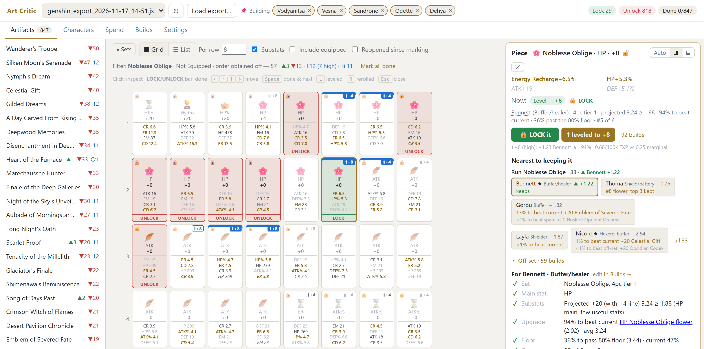
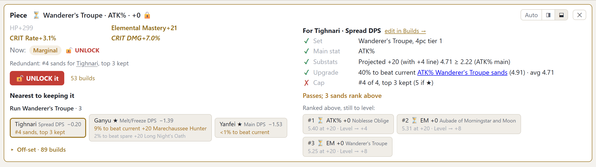
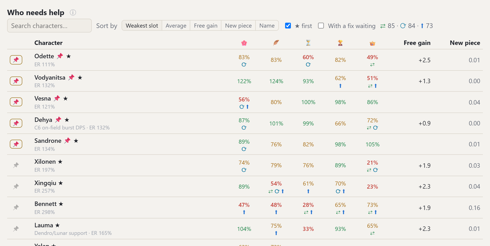
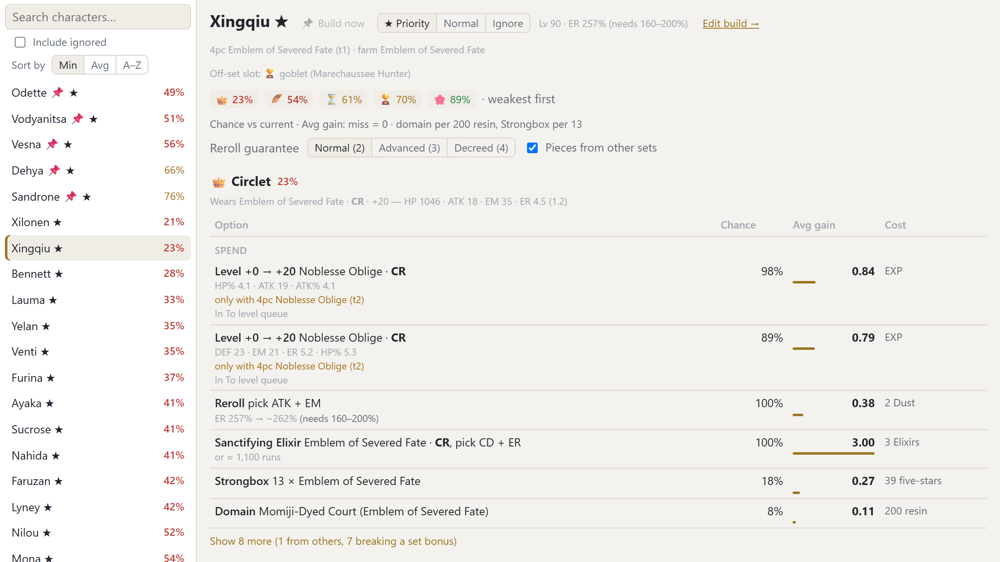
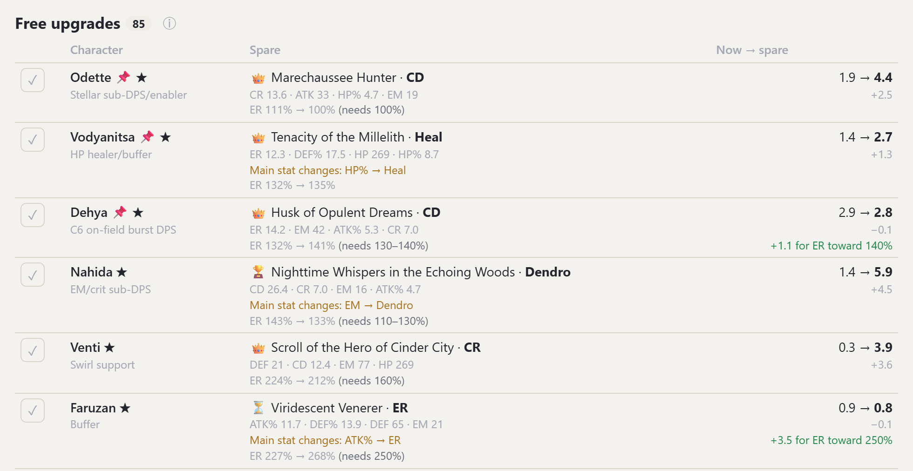
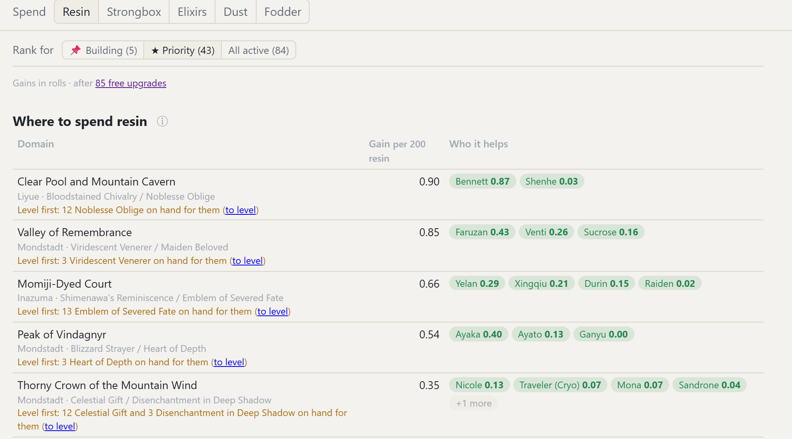
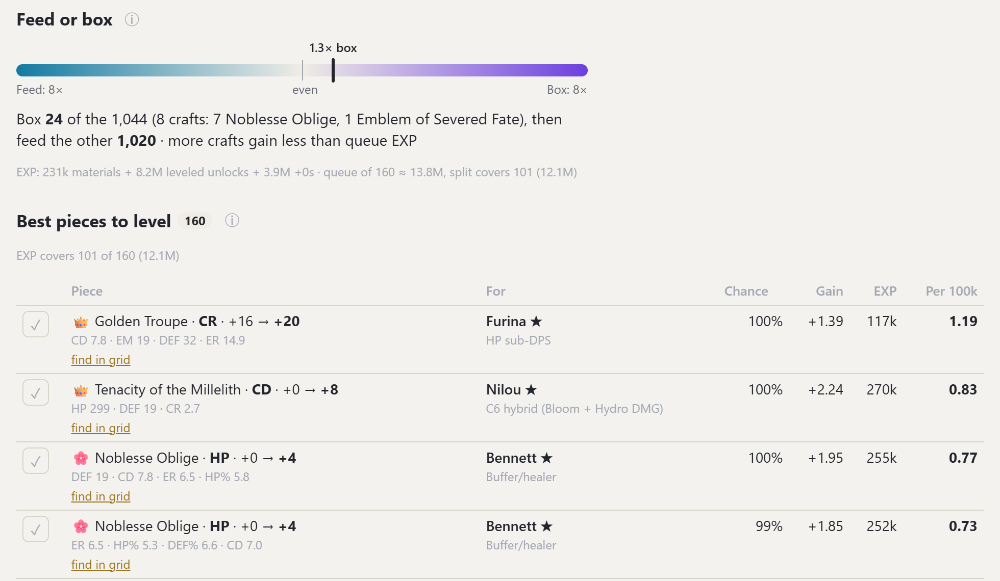
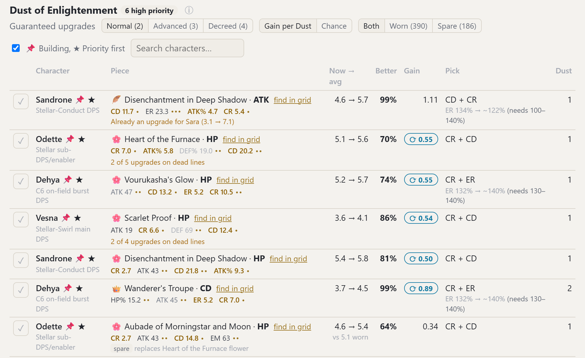
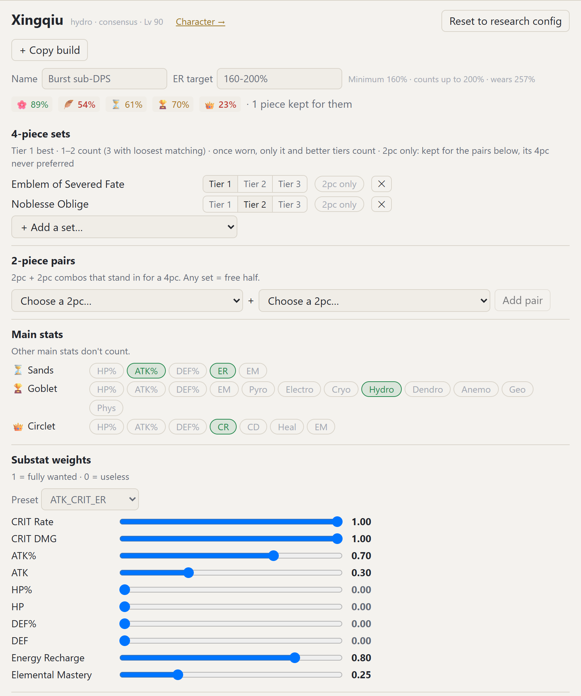

# art-critic
Know which Genshin Impact artifacts to lock, level, feed, reroll or farm.

Art Critic reads an [Irminsul](https://github.com/konkers/irminsul) export of your account and judges every 5★ piece against a researched build for each of your characters. It runs as a local web page you keep next to the game.



## Setup

1. Install [Node.js](https://nodejs.org/) 22.12 or newer.
2. Double-click `start.bat` (or run `npm install`, then `npm run dev`). The page opens at http://localhost:5317. The first start needs internet.
3. Export your account with Irminsul and press **Load export…**. It's copied into `imports/`, and the newest export loads whenever the page opens.

Then tell it who you care about:

- **Characters → Roster:** mark characters **★ Priority** (you want good pieces for them), Normal, or Ignore (don't keep pieces for them).
- **📌 Building:** pin the few you're working on right now. They lead every list, and Spend ranks for them. Unpin them from the header when you move on.
- **Builds:** every character starts with a researched build. Change the sets, main stats, substat weights or ER target to match how you play them.

Your choices are saved in `state/user-state.json`. That file and your exports stay on your machine.

## Clean up your inventory

Go through your inventory one set at a time, with the game open alongside.

1. In **Artifacts**, pick a set from the left rail. It shows how many pieces to lock (▲), unlock (▼) and level (⬆).
2. In-game, filter the inventory to that set. The grid is in the game's own order, cell for cell.
3. Follow the green **LOCK** and red **UNLOCK** bars. <kbd>Space</kbd> marks a piece done and jumps to the next.
4. Level the **⬆+4** pieces to the stop shown. The hotter the badge, the bigger the expected gain; blue and up is high priority. A dimmed **⏸** piece is kept but on hold: your EXP on hand does more elsewhere.
5. Re-export and load it. Each piece you leveled is judged again on what it actually rolled.

Click any piece to open it in the inspector. It shows why the piece got its verdict, who it's for, and **Closest build**: what would have to change for a build to keep it. Edit a build right there and the verdict updates.



Also in the Artifacts tab:

- **List view:** a card per piece, across all sets or one. Filter to lock changes, pieces to level, or everything, at any level.
- **⟳ badge:** a +20 worth a Dust of Enlightenment reroll.
- **Layout:** the inspector docks at the side or the bottom (handy on a portrait monitor), and the set rail folds away.

## Find quick boosts

**Characters → Board** lists every active character, least built first.



Each slot shows how good the worn piece is for that build (100% is a typical well-rolled +20), and any fix waiting for it:

- ⇄ a spare to equip;
- ⟳ a reroll;
- ⬆ a piece to level.

Click a character to open their page. It lists every way to improve each slot, weakest slot first, with its chance of beating what they wear, its average gain and its cost:

- spare pieces;
- pieces other characters wear;
- pieces to level;
- rerolls;
- Elixirs, the Strongbox and domains.



**Quick wins** lists the free upgrades: spare +20s that beat what someone wears, without breaking their set bonuses or dropping them below their Energy Recharge target. Tick one once you've equipped it in-game. Every tab then counts it as worn until your next export.



## Spend your resources

**Spend** ranks what to do with each resource. It ranks for your 📌 Building characters by default; switch to ★ Priority or everyone at the top.

- **Resin:** domains by expected gain per 200 resin, who each one helps, and pieces you already have that you should level first.
- **Strongbox:** the best set to craft. **Elixirs:** the best Sanctifying Elixir craft for each character.
- **Dust:** +20s ranked by how much one reroll would help, with the two lines to pick.
- **Fodder:** whether to feed your +0 unlocks or turn them in to the Strongbox, and the best pieces to spend EXP on.







## How it decides

A piece is kept for a character's build when:

1. its set is one of the build's 4pc sets, or it's good enough to be the build's one off-set piece;
2. its main stat suits the slot;
3. its substats clear the build's bar;
4. it has at least a 20% chance to end up better than what they wear once leveled, and, if it still needs leveling, to end up a good piece: 80% of a typical well-rolled +20 for that build (CRIT circlets and other rare main stats are exempt);
5. it's among the best 3 candidates for that slot (5 for ★ Priority characters).

Values are counted in rolls: one max CRIT Rate roll is 1.0. Energy Recharge counts toward each build's target and is worth nothing past it.

Every build is editable in **Builds**, and every threshold in **Settings**. [The manual](docs/manual.md) has every rule, number and screen in full.



## Development

```
npm test             # engine unit tests, plus a regression run over the newest export in imports/ (skipped without one)
npm run typecheck
```

There's no production build. The API runs inside the Vite dev server, so `npm run dev` (or `start.bat`) is how the tool runs. [AGENTS.md](AGENTS.md) maps the code.

## License

Apache 2.0, see [LICENSE](LICENSE). The stat data is downloaded from Genshin Optimizer at runtime, not redistributed here.
